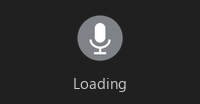

# WhisperClaude

WhisperClaude is a dictation tool for Windows that runs OpenAI's Whisper locally. A tap on Left Ctrl starts recording. A second tap stops it and pastes the transcript into the focused text field. Whisper detects the language of each passage, so one dictation can mix several languages. A tap on Left Alt translates the selected text or the dictation into one of 201 languages. Audio and text never leave the computer. On an Intel Core Ultra 7 258V with its Arc 140V iGPU, 10 s of speech is transcribed in 0.38 s.

<p align="center">
  
</p>

## Usage

Requirements: Windows 11, Python 3.12 or newer and 3–5 GB of disk space for the models. A GPU is optional: an NVIDIA GPU (CUDA) or an Intel GPU or iGPU (Core Ultra, Arc). Without one, the CPU is used.

```powershell
git clone https://github.com/philipp-sz/WhisperClaude.git
cd WhisperClaude
py scripts\setup.py
```

The setup script detects the hardware and prints what the app will use (Whisper model and device, translation model), then creates `.venv`, installs the app (with the CUDA libraries, about 1.3 GB, on an NVIDIA GPU), shows the model sizes and asks before downloading them (about 1–5 GB; `--yes` skips the question). It then runs `scripts\check_env.py` and offers autostart. `--dry-run` prints every step without doing it. It is safe to run again. Then start the app:

```powershell
.venv\Scripts\pythonw.exe -m whisperclaude     # without console (as autostart does); python.exe for a console
```

Manual install, without the script: `py -m venv .venv`, then `.venv\Scripts\python.exe -m pip install -e .` (or `-e .[cuda]` on an NVIDIA GPU). The first start downloads the models. On an iGPU it also compiles the model once, which takes about 15 s.

Autostart registers two Task Scheduler tasks without admin rights. One starts the app at login. The other restarts it after an unlock or a wake from sleep if Windows closed it. The setup script offers it; by hand:

```powershell
.venv\Scripts\python.exe scripts\install_autostart.py            # install and start
.venv\Scripts\python.exe scripts\install_autostart.py --remove   # uninstall
```

### Configuration

All settings are in [`config.toml`](config.toml) in the project folder. Each key is commented and optional. The tray menu entry "Settings (config.toml)" opens the file. "Restart to apply settings" applies changes.

The default prompt is written for German and English. For other languages, four keys should be set before the first dictation:

- `[model] initial_prompt`: one short, correctly punctuated sentence per dictation language. Whisper copies its punctuation and casing. With two languages it also keeps mixed speech from being translated into one language.
- `[model] prompt_languages`: the languages that sentence is written in. Speech in any other language is transcribed without it, since Whisper otherwise translated it into English.
- `[translation] my_languages`: the languages the user writes in, most used first. They decide the source language of short texts such as "Gracias". If the list is empty, the app uses the Windows display language, the keyboard layouts and English.
- `[model] vocabulary`: names and terms Whisper should spell exactly.

Example for Spanish and English:

```toml
[model]
initial_prompt = "Hola, esto es una prueba. Okay, so let's see how this works, and then we'll decide."
prompt_languages = ["es", "en"]
vocabulary = ["GitHub", "Kubernetes"]

[translation]
my_languages = ["es", "en"]
```

The other settings work with their defaults: hotkeys, device, models, a fixed dictation language, auto-stop, history, tray icon and status pill style, spoken commands and translation.

### Dictating

1. Click into a text field and tap Left Ctrl. A status pill shows waves that follow the voice.
2. Speak, then tap Left Ctrl again. On the Arc 140V iGPU the text is pasted 0.5 s later for a short dictation and 1.3–2.4 s later for a 5-minute dictation.
3. Esc during recording stops it without pasting. The text is kept in "Recent dictations" and marked as cancelled. The pill offers to copy it. After 60 s without speech the recording stops by itself and is kept the same way.
4. After each paste the pill shows a Copy button for 5 s. The tray menu entry "Recent dictations" keeps the last 5 dictations.

The app writes the clipboard only to paste and when Copy is clicked. It restores the previous content after pasting and after reading a selection, also if that fails.

### Translating

1. Select text in any app and tap Left Alt. A picker opens with "From" and "To" fields and a list of target languages. Recently used languages come first. Typing filters by name, native name or code.
2. Enter (or Left Alt again) translates. The selection is replaced by the translation. Esc cancels.
3. While dictating, tap Left Alt instead of the second Left Ctrl tap. The picker opens while the dictation is transcribed. Enter pastes the translation, Esc the untranslated dictation.
4. "From" is "Auto" by default and shows the detected language, for example "Auto · German". Tab switches the list to the source language. Enter takes it and goes back to the target. The user's own languages come first in that list.

"Recent dictations" keeps a translated dictation or selection as one entry. Its submenu copies either the original or the translation.

The tray icon shows the state: loading, ready, recording, transcribing and pasted. Its menu has status, recent dictations, settings, restart, log and quit.

<p align="center">
  
</p>

### Formatting by voice

Spoken commands are off by default. Set `enabled = true` in the `[commands]` section of `config.toml` to use them. A command is the trigger word "command" followed by a command word, always in English:

| Spoken | Result |
|---|---|
| `command new line` | line break |
| `command new paragraph` | blank line |
| `command bullet` | new line starting with `- ` |
| `command separator` | `---` with a blank line above and below |
| `command open quote` … `command close quote` | `"…"` |

A bullet item ends at the end of its sentence. Sentences that only contain "new line" or "bullet" stay unchanged. So does "command" after a determiner ("the command bullet"). A misheard command stays in the text.

## Features

- System-wide hotkey. Left Ctrl alone toggles recording. Ctrl+C, Ctrl+click and Ctrl+scroll do not, and neither do Ctrl events that software sends (a touchpad pinch).
- Dictation in Whisper's 100 languages, also mixed, with automatic language detection.
- Translation of selected text or a dictation into 201 languages with NLLB-200, on the GPU or CPU. The source language is detected or picked.
- Vocabulary for names and technical terms: a short list of your own (`[model] vocabulary`), passed to Whisper with the prompt.
- Self-healing: if the GPU is missing at start or after a wake, the app runs on the CPU, looks for the GPU again in the background, switches back when it returns, and only says something if it stays missing. A transcription that fails is retried once with a freshly loaded model, so the dictation is not lost. A Whisper repetition loop ("dx dx dx ...") is detected and that chunk is decoded again.
- Live transcription. Finished 30 s chunks are transcribed while recording continues.
- The previous clipboard is restored after pasting, including images and files. Dictations are never synced to the cloud clipboard.
- Status pill with three styles (`[pill] style`): color waves, gradient bars or plain bars. Quiet microphones get more gain, so the waves stay visible.
- Local history of the last 5 dictations in `%LOCALAPPDATA%\WhisperClaude\history.json`, readable only by the Windows user. `[history] keep = 0` turns it off and deletes the file.
- Works offline after the first model download. Logs never contain transcript text.
- 0% GPU while idle.

The technical overview is in [docs/how-it-works.md](docs/how-it-works.md). The experiments and measurements behind each choice are in [docs/](docs/README.md).

## Comparing engines on your own speech

`scripts\compare_gui.py` records what you say and shows what each engine heard, side by side. The Play button replays the selected recording. Write what you really said into the reference box, mark names as `[[Name]]`, and save. Wrong, missing and invented words are highlighted per engine and counted. The recordings and references stay in `bench_audio/real/` (git-ignored), so any engine can be compared later with `scripts\real_eval.py`. Models that need PyTorch (Parakeet, Granite) run through the separate environment of `scripts/model_search`. Results so far: [docs/real-recordings.md](docs/real-recordings.md).

## Development

```powershell
.venv\Scripts\python.exe -m pip install -e .[dev]
.venv\Scripts\python.exe -m pytest          # fast tests (no model, no hardware)
.venv\Scripts\python.exe -m pytest -m slow  # real models on CPU and (if present) iGPU / NVIDIA GPU
```

The slow transcription tests use two short recordings of the user's voice, made with `scripts/record_clip.py`. Recordings are git-ignored. Without them these tests are skipped.

## Limitations

- Windows only.
- Smart spacing reads the character before the caret through UI Automation. Apps that don't expose it fall back to the last paste, so the first dictation into such a field can lack its leading space.
- If another app holds the clipboard for more than a second, nothing is pasted. The dictation stays in "Recent dictations".
- The first 0.2–0.4 s after the start tap can be lost while the microphone opens.
- With the Intel iGPU backend, the app uses 6–9% of one CPU core while idle, because a thread in Intel's OpenCL runtime keeps running. The CPU backend uses 0.07%. See [docs](docs/transcription.md#idle-cpu-with-the-igpu-backend).
- Translations of one to three words can still add words or pick the wrong sense ("Einstellungen" becomes "Employment"); see [docs](docs/translation.md#short-inputs-2026-11-12).
- While the app runs, a tap of Left Alt alone no longer opens an app's menu bar. `[translation] key` sets another key.
- The NLLB-200 weights are licensed CC-BY-NC 4.0, which allows non-commercial use only.

Built with Claude Code. The author specified features, tested and reported bugs. The name refers to Claude Code.

## License

MIT, see [LICENSE.md](LICENSE.md). Dependencies are installed with pip and models are downloaded at runtime. They keep their own licenses:

| Component | License |
|---|---|
| [faster-whisper](https://github.com/SYSTRAN/faster-whisper), CTranslate2, ONNX Runtime, sounddevice, Whisper models ([OpenAI](https://github.com/openai/whisper), [Systran](https://huggingface.co/Systran/faster-whisper-small) and [OpenVINO](https://huggingface.co/OpenVINO) conversions), Silero VAD | MIT |
| OpenVINO (+ GenAI, Tokenizers), Hugging Face tokenizers / huggingface_hub | Apache-2.0 |
| NumPy, PyAV, psutil, py3langid; Pillow | BSD; MIT-CMU |
| [NLLB-200](https://huggingface.co/facebook/nllb-200-distilled-1.3B) translation models, distilled 1.3B and [600M](https://huggingface.co/facebook/nllb-200-distilled-600M) (Meta), CTranslate2 conversions ([1.3B](https://huggingface.co/OpenNMT/nllb-200-distilled-1.3B-ct2-int8), [600M](https://huggingface.co/JustFrederik/nllb-200-distilled-600M-ct2-int8)) | CC-BY-NC-4.0 |
| CUDA libraries (`[cuda]` extra, cuBLAS, cuDNN) | NVIDIA license |
| [pynput](https://github.com/moses-palmer/pynput), [pystray](https://github.com/moses-palmer/pystray) | LGPL-3.0 (unmodified, installed separately) |

This project is not affiliated with Wispr Flow.
