# WhisperClaude

WhisperClaude is a dictation tool for Windows that runs OpenAI's Whisper locally. A tap on Left Ctrl starts recording, a second tap stops it, and the transcript is pasted into the text field that has focus. It handles German, English and both mixed in one dictation. Audio never leaves the computer. On an Intel Core Ultra 7 258V with its Arc 140V iGPU, 10 s of speech is transcribed in 0.38 s.

<p align="center">
  
</p>

## Usage

Requirements: Windows 11, Python 3.12 or newer and about 2 GB of disk space for the models. An Intel GPU or iGPU (Core Ultra, Arc) is optional. Without one, the CPU is used.

```powershell
git clone https://github.com/philipp-sz/WhisperClaude.git
cd WhisperClaude
py -m venv .venv
.venv\Scripts\python.exe -m pip install -e .
.venv\Scripts\python.exe -m whisperclaude
```

The first run downloads the model. On an iGPU it also compiles the model once, which takes about 15 s. Autostart registers two Task Scheduler tasks without admin rights. One starts the app at login. The other restarts it after an unlock or a wake from sleep if Windows closed it.

```powershell
.venv\Scripts\python.exe scripts\install_autostart.py            # install and start
.venv\Scripts\python.exe scripts\install_autostart.py --remove   # uninstall
```

### Dictating

1. Click into a text field and tap Left Ctrl. A status pill shows level bars that follow the voice.
2. Speak, then tap Left Ctrl again. The text is pasted 0.5 s later for a short dictation and 1.3–2.4 s later for a 5-minute dictation.
3. Esc during recording discards the recording. After 60 s without speech the recording stops by itself, and the text goes to the clipboard instead of being pasted.
4. After each paste the pill shows a Copy button for 5 s. The tray menu entry "Recent dictations" keeps the last 5 dictations.

The tray icon shows the state: loading, ready, recording, transcribing and pasted. Its menu has status, recent dictations, settings, restart, log and quit.

<p align="center">
  
</p>

All settings are in the commented [`config.toml`](config.toml): hotkey, device, models, language, vocabulary, auto-stop, history, tray icon style and spoken commands. Tray → Restart (apply config) applies changes.

### Formatting by voice

Spoken commands are off by default. Set `enabled = true` in the `[commands]` section of `config.toml` to use them. A command is the trigger word "command" followed by a command word, always in English:

| Spoken | Result |
|---|---|
| `command new line` | line break |
| `command new paragraph` | blank line |
| `command bullet` | new line starting with `- ` |
| `command separator` | `---` with a blank line above and below |
| `command open quote` … `command close quote` | `"…"` |

A bullet item ends at the end of its sentence. Sentences that only contain "new line" or "bullet" stay unchanged, and so does "command" after a determiner ("the command bullet"). A misheard command stays in the text.

## Features

- System-wide hotkey. Left Ctrl alone toggles recording. Ctrl+C, Ctrl+click and Ctrl+scroll do not.
- German, English and mixed dictation with automatic language detection.
- Custom vocabulary for names and technical terms.
- Live transcription. Finished 30 s chunks are transcribed while recording continues.
- The previous clipboard is restored after pasting, including images and files. Dictations are never synced to the cloud clipboard.
- Local history of the last 5 dictations in `%LOCALAPPDATA%\WhisperClaude\history.json`, readable only by the Windows user. `[history] keep = 0` turns it off and deletes the file.
- Works offline after the first model download. Logs never contain transcript text.
- 0.3–0.6% of one CPU core and 0% GPU while idle.

## How it works

```mermaid
flowchart LR
    A([Tap Left Ctrl]) --> B[Record mic<br/>16 kHz mono]
    B --> C[Every 5 s: voice activity<br/>detection, split at pauses]
    C --> D[Group segments into ≤ 30 s chunks<br/>same language only, 0.5 s lead-in]
    D --> E[Transcribe finished chunks<br/>while recording]
    E --> F([Tap Left Ctrl])
    F --> G[Transcribe the<br/>remaining chunks]
    G --> H[Text fixes, optional<br/>spoken commands]
    H --> I[Save to history]
    I --> J[Clipboard + Ctrl+V<br/>into the focused app]
    J --> K[Restore the<br/>old clipboard]
```



At startup the app selects the backend. If OpenVINO finds an Intel GPU, it loads Whisper `large-v3-turbo` (int8) through OpenVINO GenAI. Otherwise, or if loading fails, it loads Whisper `small` (int8) on the CPU through faster-whisper. The hotkey, tray and pill start first, and the model loads in the background.

Voice activity detection cuts the audio at pauses, so no chunk crosses Whisper's 30 s window. Whisper detects one language per chunk. On the iGPU path, segments are therefore merged only if their detected language matches. Otherwise Whisper would translate the second language. Each chunk starts with 0.5 s of silence, which keeps Whisper from skipping the first words. A punctuated German and English example sentence plus the custom vocabulary is passed as the prompt. It sets the punctuation style and the spelling of names.

### Measurements

Intel Core Ultra 7 258V with Arc 140V iGPU, on battery:

| | OpenVINO `large-v3-turbo`, Arc 140V iGPU | faster-whisper `small`, Core Ultra 7 258V CPU |
|---|---|---|
| 10 s clip | 0.38 s | 3.6 s |
| 5-minute dictation, stop tap to text | 1.3–2.4 s | 6.6 s |
| Word error rate, own voice, short clips / long dictations | 3.4% / 4.0% | not measured |

On the iGPU, transcription uses 2.3 s of GPU time per minute of audio, an estimated 20 J of extra energy. Measurements and the reasons for each choice are in [`docs/decisions.md`](docs/decisions.md).

## Development

```powershell
.venv\Scripts\python.exe -m pip install -e .[dev]
.venv\Scripts\python.exe -m pytest          # fast tests (no model, no hardware)
.venv\Scripts\python.exe -m pytest -m slow  # real models on CPU and (if present) iGPU
```

The slow tests need two short recordings of the user's voice, made with `scripts/record_clip.py`. Recordings are git-ignored. Without them the slow tests are skipped.

## Limitations

- Windows only.
- No leading space is inserted when dictating after existing text. The app cannot read the content of the text field.
- The NPU is not used, because OpenVINO 2026.4's Whisper pipeline crashes on it.
- The CPU path merges chunks without language detection, so mixed German and English can be translated into one language.
- The first 0.2–0.4 s after the start tap can be lost while the microphone opens.

Built with Claude Code. The author specified features, tested and reported bugs. The name refers to Claude Code.

## License

MIT, see [LICENSE.md](LICENSE.md). Dependencies are installed with pip and models are downloaded at runtime. They keep their own licenses:

| Component | License |
|---|---|
| [faster-whisper](https://github.com/SYSTRAN/faster-whisper), CTranslate2, ONNX Runtime, sounddevice, Whisper models ([OpenAI](https://github.com/openai/whisper), [Systran](https://huggingface.co/Systran/faster-whisper-small) and [OpenVINO](https://huggingface.co/OpenVINO) conversions), Silero VAD | MIT |
| OpenVINO (+ GenAI, Tokenizers), Hugging Face tokenizers / huggingface_hub | Apache-2.0 |
| NumPy, PyAV, psutil; Pillow | BSD; MIT-CMU |
| [pynput](https://github.com/moses-palmer/pynput), [pystray](https://github.com/moses-palmer/pystray) | LGPL-3.0 (unmodified, installed separately) |

This project is not affiliated with Wispr Flow.
