# How it works

## Pipeline

```mermaid
flowchart LR
    A([Tap Left Ctrl]) --> B[Record mic<br/>16 kHz mono]
    B --> C[Every 5 s: voice activity<br/>detection, split at pauses]
    C --> D[Group segments into ≤ 30 s chunks<br/>same language only, 0.5 s lead-in]
    D --> E[Transcribe finished chunks<br/>while recording]
    E --> F([Tap Left Ctrl])
    F --> G[Transcribe the<br/>remaining chunks]
    G --> H[Text fixes, optional<br/>spoken commands]
    H --> I[Save to history]
    I --> J[Clipboard + Ctrl+V into the focused app,<br/>a leading space if behind text]
    J --> K[Restore the<br/>old clipboard]
```

## Startup and backends

The hotkey, tray icon and status pill start first. The models load in the background, so a tap during loading gets a "still loading" hint instead of being lost. The logon and wake tasks often start the app while it already runs; such a duplicate checks the single-instance lock before loading any library and exits in 0.13 s (0.6 s before).

The app then selects the Whisper backend:

- NVIDIA GPU: faster-whisper on CUDA with beam search. The model depends on the free GPU memory: `large-v3` in float16 with at least 7 GB, `large-v3` in int8 (2.1 GB) with at least 4 GB, else `large-v3-turbo` in int8.
- Intel GPU or iGPU: `large-v3-turbo` (int8) through OpenVINO GenAI. The compiled kernels are cached, so only the first start takes about 15 s.
- CPU, or if loading fails: Whisper `small` (int8) through faster-whisper.

If the GPU is missing (on 2026-11-10 the iGPU vanished after a wake until Windows was restarted), the app does not stay on the CPU silently. It remembers the device of the last good start (`device.txt` in the data folder). A CPU start on a machine that last ran on a GPU counts as degraded: a minute after the start, at every wake and every 5 minutes it checks for the GPU in a short-lived subprocess (0.4 s; a vanished device can stay vanished inside the running process). When the GPU is back, the model is loaded on it in the background and replaces the CPU model as soon as nothing is running. Only after two failed checks does the pill say so (restarting Windows is what helped). A transcription that fails (for example after a GPU driver reset) loads the model again and transcribes the same audio once more, so the dictation is not lost. Code: `recovery.py`, `gpu_present()` in `system.py`.

The NPU of Intel Core Ultra laptops can run Whisper turbo at about the iGPU's speed, but in OpenVINO GenAI 2026.4 not with a prompt, and without the prompt it translated whole German recordings into English (19% errors on the author's recordings against 4.7%). It is therefore not a fallback tier yet; see [real-recordings.md](real-recordings.md).

The reasons for each choice are in [transcription.md](transcription.md).

## Chunking

Voice activity detection (Silero, through faster-whisper) cuts the audio at pauses, so no chunk crosses Whisper's 30 s window. Silero rates every 32 ms window with a speech probability; speech starts above 0.5 and ends after 2 s below 0.35, and every segment is padded by 0.4 s. Its probabilities depend on the level, so quiet audio is amplified for the VAD only (to −26 dBFS, at most +20 dB; the model gets the original audio): a quiet recording had lost whole passages. Whisper detects one language per chunk. On the GPU paths, segments are therefore merged only if their detected language matches. Otherwise Whisper would translate the second language into the first. Each detection is a full encoder pass (about 270 ms on the iGPU), so during a dictation every segment is detected as soon as it has ended (2.5 s later), not after the stop tap; a dictation with a single segment needs none. Each chunk starts with 0.5 s of silence, which keeps Whisper from skipping the first words. A punctuated example sentence in the dictation languages plus the custom vocabulary is passed as the prompt. It sets the punctuation style and the spelling of names. The vocabulary is the manual list in `config.toml`; prompt and vocabulary together must stay within Whisper's 223 prompt tokens.

Greedy decoding can fall into a loop ("x² dx dx dx ..."). A chunk whose text compresses more than 2.4 times with zlib (Whisper's own criterion; normal text: at most 1.9) or has more than 6 words per second is decoded again with a repetition penalty of 1.1 (beam search, which also found the text, is not implemented on the iGPU). If the retry loops too, the repeats are collapsed. On CUDA and the CPU, faster-whisper's own temperature fallback does this.

While recording, finished chunks are already transcribed. After the stop tap only the last chunk remains, so a 5-minute dictation is pasted 1.3–2.4 s after the tap on the iGPU.

## Translation

The translation model is NLLB-200, run through CTranslate2 (int8) on an NVIDIA GPU or the CPU. CTranslate2 has no Intel GPU backend. The text is split into sentences, and line breaks and list markers are kept. The source language is detected per sentence with py3langid, with the user's own languages weighted for short texts, or picked in the language picker. The model is unloaded after 10 idle minutes (`unload_after_min`) and loaded again when the translate key is tapped, so the load overlaps the language picker. On the CPU it is not loaded at startup. See [translation.md](translation.md#unloading-the-model-when-idle-2026-11-11). Details and the model comparison are in [translation.md](translation.md).

## Keys

A low-level keyboard hook watches for a tap of Left Ctrl alone. Ctrl+C, Ctrl+click and Ctrl+scroll are not taps. Neither are Ctrl events marked as injected by software: a precision-touchpad pinch reaches apps as Ctrl + wheel, and recordings had started by themselves while two fingers were on the touchpad. The translate key (Left Alt) is detected inside the hook: a tap's key-up is swallowed and replayed behind an unassigned key, so the focused app does not open its menu bar.

A start tap opens the microphone on a worker thread. The pill shows "Starting…" until the first audio arrives and only then turns red: after an idle spell, Windows' audio engine needs 0.3–0.7 s before audio flows, and speech before the red pill is not recorded. At the stop tap the stream is stopped at once (so the end of the last word is kept) and closed in the background (70 ms less per dictation).

## Clipboard and history

The app writes the clipboard only to paste and restores the previous content afterwards. Before pasting it checks the character before the caret and adds a leading space when the dictation would run into text ([interface.md](interface.md#spacing-at-the-insertion-point)). Dictations that are not pasted stay in the local history, see [interface.md](interface.md#clipboard-and-history).

## Measurements

Laptop: Intel Core Ultra 7 258V with Arc 140V iGPU, on battery.

| | OpenVINO `large-v3-turbo`, Arc 140V iGPU | faster-whisper `small`, Core Ultra 7 258V CPU |
|---|---|---|
| 10 s clip | 0.38 s | 3.6 s |
| 5-minute dictation, stop tap to text | 1.3–2.4 s | 6.6 s |
| Word error rate, own voice, short clips / long dictations | 3.4% / 4.0% | not measured |

On the iGPU, transcription uses 2.3 s of GPU time per minute of audio, an estimated 20 J of extra energy.

Desktop: Core i5-10600K with RTX 4070. `large-v3` (float16, beam 5) transcribes a 10 s dictation in 0.82 s and made 11–19% fewer errors than `large-v3-turbo` (0.33 s) on FLEURS read speech in German and English.

Translation of a 3-sentence dictation: 0.77 s with NLLB-600M on the Core i5-10600K (4 threads), 0.35 s with NLLB-1.3B on the RTX 4070, 0.4 s with NLLB-600M and 0.6 s with NLLB-1.3B on the laptop's CPU (4 threads). On FLORES-200 (12 directions, 200 sentences each), NLLB-600M scored 85.2 COMET, NLLB-1.3B 86.7 and M2M100-418M 81.7. NLLB-1.3B is the default unless RAM (CPU) or free VRAM (NVIDIA GPU) is short.

While idle, the app uses no GPU time and 0.07% of one CPU core on the CPU backend. With the Intel iGPU backend it uses 6–9% of one core on the laptop, because a thread in Intel's OpenCL runtime keeps changing the system timer resolution (see [transcription.md](transcription.md#idle-cpu-with-the-igpu-backend)).

## Backend limitations

- The NPU is not used: OpenVINO 2026.4 runs Whisper there only without a prompt, and then it translated German recordings into English (see above).
- The CPU path merges chunks without language detection, so mixed German and English can come out in one language.
- On Intel hardware the translation runs on the CPU.
