# How it works

## Pipeline

```mermaid
flowchart LR
    A([Tap Left Ctrl]) --> B[Record mic<br/>16 kHz mono]
    B --> C[Every 5 s: voice activity<br/>detection, split at pauses]
    C --> D[Group segments into ≤ 30 s chunks<br/>same language only, 0.5 s lead-in]
    D --> E[Transcribe finished chunks<br/>while recording]
    E --> F([Tap Left Ctrl])
    F --> G[Transcribe the<br/>remaining chunks]
    G --> H[Text fixes, optional<br/>spoken commands]
    H --> I[Save to history]
    I --> J[Clipboard + Ctrl+V<br/>into the focused app]
    J --> K[Restore the<br/>old clipboard]
```

## Startup and backends

The hotkey, tray icon and status pill start first. The models load in the background, so a tap during loading gets a "still loading" hint instead of being lost.

The app then selects the Whisper backend:

- NVIDIA GPU: faster-whisper on CUDA with beam search. The model depends on the free GPU memory: `large-v3` in float16 with at least 7 GB, `large-v3` in int8 (2.1 GB) with at least 4 GB, else `large-v3-turbo` in int8.
- Intel GPU or iGPU: `large-v3-turbo` (int8) through OpenVINO GenAI. The compiled kernels are cached, so only the first start takes about 15 s.
- CPU, or if loading fails: Whisper `small` (int8) through faster-whisper.

The reasons for each choice are in [transcription.md](transcription.md).

## Chunking

Voice activity detection cuts the audio at pauses, so no chunk crosses Whisper's 30 s window. Whisper detects one language per chunk. On the GPU paths, segments are therefore merged only if their detected language matches. Otherwise Whisper would translate the second language into the first. Each chunk starts with 0.5 s of silence, which keeps Whisper from skipping the first words. A punctuated example sentence in the dictation languages plus the custom vocabulary is passed as the prompt. It sets the punctuation style and the spelling of names.

While recording, finished chunks are already transcribed. After the stop tap only the last chunk remains, so a 5-minute dictation is pasted 1.3–2.4 s after the tap on the iGPU.

## Translation

The translation model is NLLB-200, run through CTranslate2 (int8) on an NVIDIA GPU or the CPU. CTranslate2 has no Intel GPU backend. The text is split into sentences, and line breaks and list markers are kept. The source language is detected per sentence with py3langid, with the user's own languages weighted for short texts, or picked in the language picker. Details and the model comparison are in [translation.md](translation.md).

## Keys

A low-level keyboard hook watches for a tap of Left Ctrl alone. Ctrl+C, Ctrl+click and Ctrl+scroll are not taps. The translate key (Left Alt) is detected inside the hook: a tap's key-up is swallowed and replayed behind an unassigned key, so the focused app does not open its menu bar.

## Clipboard and history

The app writes the clipboard only to paste and restores the previous content afterwards. Dictations that are not pasted stay in the local history, see [interface.md](interface.md#clipboard-and-history).

## Measurements

Laptop: Intel Core Ultra 7 258V with Arc 140V iGPU, on battery.

| | OpenVINO `large-v3-turbo`, Arc 140V iGPU | faster-whisper `small`, Core Ultra 7 258V CPU |
|---|---|---|
| 10 s clip | 0.38 s | 3.6 s |
| 5-minute dictation, stop tap to text | 1.3–2.4 s | 6.6 s |
| Word error rate, own voice, short clips / long dictations | 3.4% / 4.0% | not measured |

On the iGPU, transcription uses 2.3 s of GPU time per minute of audio, an estimated 20 J of extra energy.

Desktop: Core i5-10600K with RTX 4070. `large-v3` (float16, beam 5) transcribes a 10 s dictation in 0.82 s and made 11–19% fewer errors than `large-v3-turbo` (0.33 s) on FLEURS read speech in German and English.

Translation of a 3-sentence dictation: 0.77 s with NLLB-600M on the Core i5-10600K (4 threads), 0.35 s with NLLB-1.3B on the RTX 4070, 0.4 s with NLLB-600M and 0.6 s with NLLB-1.3B on the laptop's CPU (4 threads). On FLORES-200 (12 directions, 200 sentences each), NLLB-600M scored 85.2 COMET, NLLB-1.3B 86.7 and M2M100-418M 81.7. NLLB-1.3B is the default unless RAM (CPU) or free VRAM (NVIDIA GPU) is short.

While idle, the app uses 0.3–0.6% of one CPU core and no GPU time.

## Backend limitations

- The NPU is not used, because OpenVINO 2026.4's Whisper pipeline crashes on it.
- The CPU path merges chunks without language detection, so mixed German and English can come out in one language.
- On Intel hardware the translation runs on the CPU.
